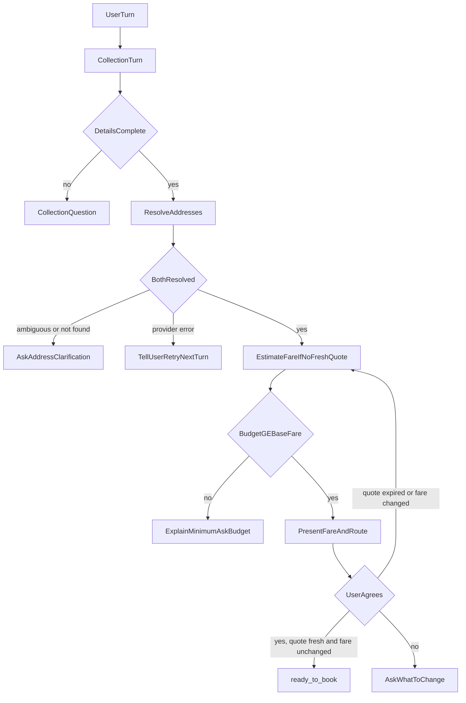

# Address resolution and fare estimation

**Status:** implemented  
**Date:** 2026-10-16

Starts when detail collection reports `details_complete`. Resolves pickup and destination through the logistics provider, obtains a fare quote, checks it against the user's budget, and gets explicit consent. Booking creation is out of scope; this module ends at `ready_to_book` and exposes a guard that booking creation must call.

## Locked decisions

- **The provider is the only source of truth** for address resolution and fares. The AI never invents a fare, never marks an address resolved without a provider `resolved` result, and never edits a quoted amount. Every number or address shown to the user is read from provider data.
- Provider access is a `LogisticsProvider` protocol (`resolve_address`, `estimate_fare`). v1 ships a deterministic `FakeLogisticsProvider` for tests and local runs; a real adapter drops in behind the same interface. The provider is injected into the API like the store (`get_provider`).
- **Budget is not asked again.** `sender_max_budget` is already collected by Task 1. Here it is validated against the quote (algorithm steps 5-7); the user is only asked for a new budget when it is too low.
- **Minimum budget = the provider's base fare.** Budget must be `>=` base fare, in the quote currency. A budget with no currency is assumed to be in the quote currency; a different currency is treated as not usable and the user is asked for a budget in the quote currency.
- **Derived validity, not imperative invalidation.** Each resolution and quote records the exact inputs it was derived from (address text, place ids). It is used only while those inputs equal the current details. So changing an address makes the old resolution and quote unusable automatically, with no cleanup path to forget.
- **Consent is bound to a fingerprint** of all user details plus the quote id and fare at the time the user said yes. Any change to details, quote or fare voids it.
- Provider failures (timeout, error) never leave state half-written and never produce a guess. The user is told the check could not be completed; the next user turn retries.
- Time is injected (`now`) so expiry is testable.

## Algorithm

Runs after every user turn, on top of detail collection. Collection runs first (extract, merge, validate, so corrections work in any state). If collection still has gaps, its question is asked and this module does nothing else. Otherwise:

1. For each address (pickup first) with no resolution matching its current text, call `resolve_address`.
   - `resolved` (one match): store the provider's formatted address and place id.
   - `ambiguous` (several matches): store candidates, ask the user to pick one (numbered). A reply that selects a candidate (number or matching text) is accepted as provider-confirmed.
   - `not_found`: ask for a corrected address. The corrected text goes back through collection validation and then resolution again.
   - timeout/error: tell the user, change nothing, retry next turn.
   Ask about **one** address at a time.
2. Both resolved: if there is no quote matching the resolved pair, or the quote has expired, call `estimate_fare`.
3. Compare budget with `base_fare`. Below minimum (or wrong currency): explain the minimum, ask for a revised budget (`sender_max_budget`), status `budget_revision`.
4. Budget OK: present the resolved route (addresses, distance, duration), base fare and quote expiry; ask whether to proceed. Status `awaiting_confirmation`.
5. User turn in `awaiting_confirmation`, with no detail change in that turn:
   - affirmative: re-check the quote. Unexpired: accept. Expired: re-estimate. Same fare: accept on the new quote. Changed fare: do not accept; present the new fare and ask again.
   - negative: do not accept; ask what to change.
   - anything else: re-ask.
6. Accepted: store consent, status `ready_to_book`, `booking.result` becomes a `ready_to_book` result with the quote.



## State schema

`Session.booking.quote` (`QuoteState`, new, default null). `BookingStatus` gains `address_clarification`, `budget_revision`, `ready_to_book` (existing `awaiting_confirmation` is reused).

- `pickup` / `destination`: `AddressResolution`
  - `input`: the exact text submitted
  - `status`: `resolved` | `ambiguous` | `not_found`
  - `resolved`: `{place_id, formatted_address}` when resolved
  - `candidates`: list of the same, when ambiguous
- `quote`: `FareQuote` from the provider
  - `quote_id`, `base_fare` (decimal string), `currency`, `expires_at`
  - `route`: `{distance_km, duration_min}`
  - `pickup_place_id`, `destination_place_id` (what it was priced for)
- `presented_fare`: base fare + currency last shown to the user
- `acceptance`: `{quote_id, base_fare, currency, fingerprint, accepted_at}` or null

`booking.result` when ready:

```json
{
  "type": "ready_to_book",
  "pickup": {"place_id": "...", "formatted_address": "..."},
  "destination": {"place_id": "...", "formatted_address": "..."},
  "quote": {"quote_id": "...", "base_fare": "5000", "currency": "NGN", "expires_at": "..."},
  "sender_max_budget": {"amount": "8000", "currency": "NGN"},
  "details": { "...Task 1 result fields..." }
}
```

`next_actions` uses `ask_user` (+ `field`) for clarification and budget, `confirm` (+ `field: "proceed"`) when awaiting consent, `none` when ready.

## Booking guard

`ensure_bookable(session, provider, now)` is the only way later code may obtain a quote to book with. It raises `AppError 409` with code:

- `not_confirmed`: no acceptance, or the fingerprint no longer matches the details/quote (a detail changed).
- `quote_changed`: the quote expired and the re-estimate returned a different fare/currency. Consent is cleared and the user must be asked again.

It mutates the session before raising (consent cleared on `quote_changed`), so callers must persist the session even when it raises. If the quote expired but the re-estimate returns the same fare, the new quote replaces the old one and the guard passes. This covers "stale quote cannot create a booking without revalidation" and "provider changes the fare between estimation and booking".

## Edge cases

| Case | Behavior |
| --- | --- |
| Resolution times out / provider error | Nothing stored; user told to retry; retried on next turn |
| Several locations match | Candidates listed; user picks; picked candidate is provider-confirmed |
| Not found | Ask for a corrected address; corrected text re-validated then re-resolved |
| Quote expires before user accepts | Re-estimate on the accept turn; same fare accepts, changed fare re-presents |
| Fare changes before booking | `ensure_bookable` re-estimates after expiry; changed fare -> `quote_changed`, consent cleared |
| Address changed after quote | Old resolution/quote unusable (inputs differ); re-resolve, re-quote, re-ask consent |
| Budget below base fare | Minimum explained; `budget_revision`; asked for new budget |
| Budget in a different currency | Treated as unusable; asked for a budget in the quote currency |
| Any detail changed after consent | Consent void; `awaiting_confirmation` again |
| Estimate fails after addresses resolve | Addresses kept; user told to retry; fare retried next turn |

## Acceptance criteria -> where enforced

- No invented fare / unconfirmed address: replies are built only from `QuoteState` fields populated from provider responses; `resolved` is set only from a provider `resolved` result or a provider-supplied candidate.
- Changing an address invalidates the quote: derived validity (`quote` matches resolved place ids; resolutions match input text).
- Stale quote cannot book: `ensure_bookable`.
- Budget >= provider minimum: step 3 on every turn, so a later budget edit is re-checked.
- Explicit agreement before booking: `acceptance` required by `ensure_bookable`.

## Layout

```
app/quoting/
  models.py     QuoteState, AddressResolution, FareQuote, Acceptance (no collection imports)
  provider.py   LogisticsProvider protocol, ProviderError, ProviderTimeout
  fake.py       deterministic FakeLogisticsProvider
  prompts.py    all user-facing wording
  engine.py     advance(): resolve -> quote -> budget -> present -> consent; ensure_bookable()
app/conversation.py   one turn = collection turn, then quoting turn (route calls this)
```

`app/collection/models.py` keeps `BookingState` (adds `quote`, new statuses) and `ReadyToBookResult`; `app/quoting` depends on collection models, not the reverse, except `BookingState.quote` referencing `quoting.models` (which has no collection imports).

## Wiring

`app/conversation.py: handle_user_turn` is the single entry point used by `POST /v1/sessions/{id}/messages`. A reply that picks among provider candidates is handled before collection; otherwise collection runs, then `quoting.advance`. The API default provider is `FakeLogisticsProvider` until a real adapter is configured (`get_provider` is the injection point).

## Tests

- Resolution: resolved, ambiguous + pick by number, not found + correction, timeout leaves state unchanged and retries.
- Quote: fare shown equals provider fare; no quote before both resolved.
- Invalidation: changing pickup/destination discards quote and consent.
- Budget: below minimum asks revision; revised budget proceeds; currency mismatch.
- Consent: explicit yes required; no/other does not accept; detail change voids consent.
- Expiry / fare change: accept after expiry with same fare passes; changed fare re-presents; `ensure_bookable` 409s.
- API: full flow through `POST /v1/sessions/{id}/messages` with an injected provider.

## Follow-ups

- Real provider adapter(s) behind `LogisticsProvider`
- Booking creation consuming `ensure_bookable`
- Provider-side price components beyond base fare (surcharges, vehicle options)
