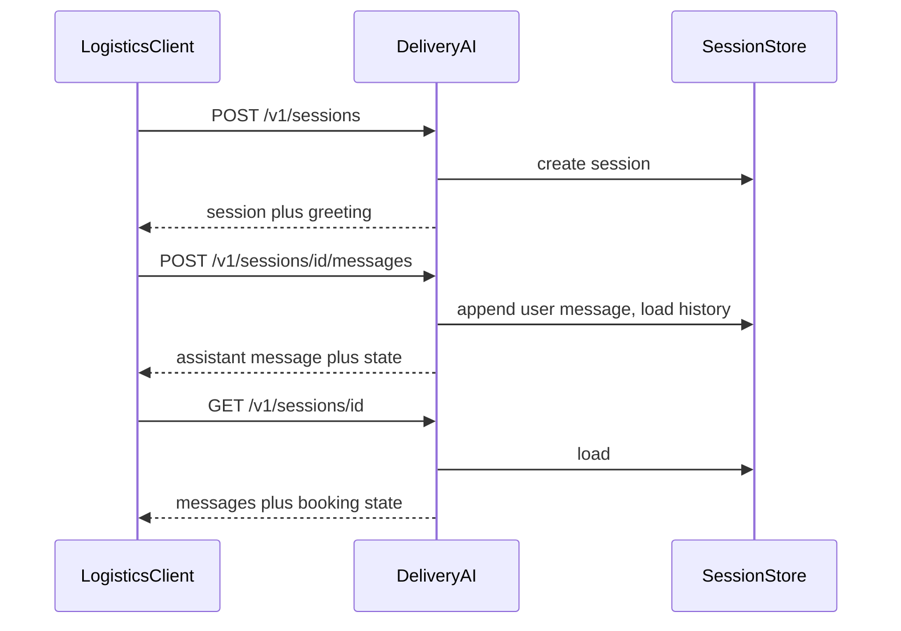

# API contract v1

**Status:** implemented  
**Date:** 2026-10-16

Logistics-agnostic HTTP contract for booking conversations. The AI service owns session state. Integrating companies send only new user turns.

## Locked decisions

- **Stack:** Python, FastAPI, Pydantic v2. OpenAPI is generated at `/openapi.json`; Swagger UI at `/docs`.
- **Auth:** `X-API-Key` per company. The key maps to `company_id`. Sessions are never shared across companies.
- **State ownership:** This service persists conversation history and booking progress. Clients do not send the full transcript.
- **Voice:** Enters as transcribed text on the message endpoint (`channel: voice_transcript`). Speech-to-text is out of this API.
- **Persistence in this deliverable:** In-memory store behind a protocol. A database can replace it later without changing the HTTP contract.
- **Plan documents:** Every plan is stored under `docs/plans/YYYY-MM-DD-short-name.md`.

## Endpoints

| Method | Path | Purpose |
| --- | --- | --- |
| `POST` | `/v1/sessions` | Start a booking conversation |
| `POST` | `/v1/sessions/{session_id}/messages` | Send a user turn; receive assistant reply + state |
| `GET` | `/v1/sessions/{session_id}` | Retrieve current conversation state |
| `GET` | `/health` | Liveness (no auth) |

All session routes require `X-API-Key`. Responses include a human-readable assistant turn (when applicable) and structured booking state.

### `POST /v1/sessions`

Optional body: `channel`, `locale`, `external_ref`, `metadata`.

Response: `Session` (may include an initial assistant greeting).

### `POST /v1/sessions/{session_id}/messages`

Body: `content` (required), `channel`, `client_message_id` (idempotency).

History is not in the body. Duplicate `client_message_id` returns the same assistant reply.

Response: `MessageTurnResponse` (assistant `message` + full `session`).

### `GET /v1/sessions/{session_id}`

Returns current messages and booking state.

- `404` if the session does not exist for this company
- `403` is unused for unknown ids (avoid session-id probing); wrong-tenant lookup is treated as `404`

## Schemas

### Message

`id`, `role` (`user` | `assistant` | `system`), `content`, `channel`, `created_at`

### BookingState

- `status`: `collecting` | `ready_for_quote` | `awaiting_confirmation` | `completed` | `cancelled`
- `collected`: optional `pickup`, `dropoff`, `ready_at`, `package`, `contact`
- `missing_fields`: ordered slot paths still required
- `next_actions`: `{ type: ask_user | confirm | none, prompt }`

Slots stay generic (addresses, time, package, contact). No carrier-specific fields in v1.

### Session

`id`, `company_id`, `status` (`active` | `completed` | `cancelled`), `locale`, `channel`, `external_ref`, `metadata`, `messages`, `booking`, `created_at`, `updated_at`

### Errors

`{ "error": { "code", "message", "details?" } }`

| Status | When |
| --- | --- |
| 401 | Missing or invalid API key |
| 404 | Session not found for this tenant |
| 409 | Session is not accepting messages |
| 422 | Validation error |

## Auth stub

`API_KEYS` env: comma-separated `key:company_id` pairs, e.g. `dev-key:acme`.

## Out of scope

- Speech-to-text / audio upload
- Real LLM orchestration
- Postgres / Redis
- Webhooks when booking is ready to quote
- Company-specific field mapping

## Follow-ups

- Replace in-memory store with a database
- Wire a model provider behind the same message contract
- Optional webhook when `booking.status` becomes `ready_for_quote`
