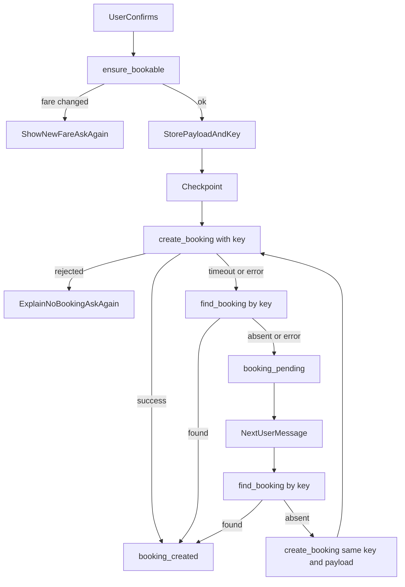

# Booking confirmation and creation

**Status:** implemented  
**Date:** 2026-10-16

Creates the delivery request with the logistics provider, but only after the user has seen the full summary and explicitly confirmed. Starts when the quoting module reports `ready_to_book`; ends with a provider booking reference and status stored on the session. Courier offers, cancellation and modification after creation are out of scope.

## Locked decisions

- **Own module:** `app/booking_request/`, with its own provider protocol, fake, prompts, engine, models and tests. It does not import from `app.quoting.engine`; it reads quote state through `app.quoting.models` and calls the quoting guard `ensure_bookable` only.
- **One confirmation, not two.** The quote presentation from Task 2 *is* the review step. It now shows the full summary (pickup, destination, package, recipient name and phone, base fare, maximum budget) and asks the user to confirm or say what to change. The user's explicit "yes" is the confirmation that this module acts on. Creation happens in that same turn. No second "are you sure?".
- **The provider's response is the only authority** on whether a booking exists. The AI says "created" only after a successful provider response (or a successful lookup by idempotency key), and never claims a booking exists after a rejection or while the outcome is unknown.
- **Idempotency key = `uuid5(session.id, "booking:<generation>")`.** Deterministic, so a retry, a duplicate confirmation, or a restart reuses the same key. `generation` increments only after a definite rejection, so a deliberate re-confirmation after rejection uses a new key.
- **Payload is frozen at first submission.** The exact payload and key are stored before the provider is called. Retries resend the stored payload with the stored key; they never rebuild it from changed details.
- **Persist before sending.** The session is checkpointed with the pending request *before* the provider call (`checkpoint` callback), so a crash or restart mid-call leaves a recoverable `booking_pending` request.
- **Unknown outcome is reconciled before it is retried:** look up by key first; only if the provider has no such booking, resend create with the same key. Because the key is idempotent at the provider, the resend cannot duplicate.
- Provider is injected (`get_booking_provider`) like the logistics provider; a real adapter may implement both protocols on one object. v1 ships a scriptable fake.
- `handle_user_turn` takes `booking_provider=None` to run the conversation without creation (used by the quoting tests).

## Algorithm

1. Quoting presents the full summary and asks to confirm (Task 2 flow). Corrections go back through collection validation and, if addresses or fare inputs change, resolution and a fresh quote; consent is voided on any change (already enforced by quoting).
2. User confirms. Quoting sets `ready_to_book` (acceptance bound to the current details + fare).
3. `submit`:
   - call `ensure_bookable` (revalidates an expired quote; a changed fare voids consent and the user is shown the new fare and asked again; no booking);
   - build the payload from the validated details, resolved places and accepted quote;
   - store `request {key, payload, status=pending}`, set `booking_pending`, **checkpoint**;
   - call `create_booking(payload, key)`.
4. Outcomes:
   - **success:** store reference + provider status; `booking_created`; `booking.result` becomes `booking_created`; tell the user it is created and awaiting courier offers (status text from the stored provider status).
   - **rejected** (provider validation error or refusal): store nothing as created; clear acceptance; `generation += 1`; status `awaiting_confirmation`; tell the user what the provider said and that no booking was made; they can correct details or reply yes to try again.
   - **timeout / provider error (unknown):** stay `booking_pending`; try one lookup by key; found -> created; otherwise tell the user it is unconfirmed (not booked, not failed) and will be re-checked on their next message.
5. Any later message while `booking_pending`: reconcile (lookup by key; absent -> resend stored payload with same key). While `booking_created`: no collection, no quoting, no create; reply with the stored reference and status.



## Provider interface

```
create_booking(payload: BookingPayload, idempotency_key: str) -> ProviderBooking
find_booking(idempotency_key: str) -> ProviderBooking | None
```

`create_booking` with a key the provider has already seen must return the existing booking. Errors: `BookingRejected(message)` is a definite refusal; `BookingTimeout` and `BookingProviderError` mean the outcome is unknown. `ProviderBooking` is `{reference, status}`.

`BookingPayload`: pickup and destination (`place_id`, `formatted_address`), `package_description`, `recipient_name`, `recipient_phone`, `sender_phone`, `quote_id`, `base_fare`, `currency`, `max_budget {amount, currency}`.

## State schema

`BookingStatus` gains `booking_pending`, `booking_created`. `Session.booking.creation` (`CreationState`, default null):

- `generation`: int, bumped after a definite rejection
- `request`: `{idempotency_key, payload, status: pending|created, attempts, reference, provider_status}` or null
- `last_error`: provider's most recent rejection message

`booking.result` when created:

```json
{ "type": "booking_created", "reference": "BK-00001", "provider_status": "awaiting_offers", "payload": { "...": "..." } }
```

## Failure handling

| Case | Behavior |
| --- | --- |
| Provider rejects / validation error | Explain the reason; say no booking was created; consent cleared; new key on the next attempt |
| Timeout, outcome unknown | `booking_pending`; lookup by key, then resend with same key; user told it is unconfirmed |
| Crash/restart mid-call | Pending request restored from SQLite; reconciled on next message |
| Duplicate "yes" / duplicate message | `booking_created` returns the stored reference; no create call |
| Duplicate `client_message_id` | Cached reply (existing API behavior) |
| User declines or changes mind before submission | No create call; ask what to change |
| Details change after rejection | Normal collection -> quote -> confirm path; new key |
| Quote expired / fare changed at submit | `ensure_bookable` voids consent; new fare shown; no booking |
| Message after creation | Stored reference and status; changes/cancellation not supported yet (said plainly) |

## Acceptance criteria -> where enforced

- No booking without explicit confirmation: `submit` runs only from `ready_to_book`, which requires quoting's acceptance; `ensure_bookable` rechecks it.
- No duplicates: deterministic key, stored payload, lookup-before-resend, `booking_created` short-circuit.
- Provider decides: status becomes created only from a successful create/lookup response.
- Restart recovery: checkpoint before send; all state is in the SQLite session document.
- Accurate status: replies are built from the stored provider reference and status.

## Layout

```
app/booking_request/
  models.py    BookingPayload, ProviderBooking, BookingRequest, CreationState, BookingCreatedResult
  provider.py  BookingProvider protocol, BookingRejected, BookingTimeout, BookingProviderError
  fake.py      scriptable, idempotent FakeBookingProvider
  prompts.py   user-facing wording
  engine.py    submit(), on_message() (pending/created handling)
```

Like quoting, `models.py` imports nothing from `app.collection`, because `BookingState` (in `app.collection.models`) references it.

## Tests

Confirmation required; decline creates nothing; success stores reference/status; duplicate yes returns same booking; rejection (no booking claimed, retry gets a new key); timeout before/after provider processed (one booking either way, same key); lookup failure stays pending; restart recovery through SQLite with a checkpoint; fare change at submit asks again; API flow to `booking_created`.

## Follow-ups

- Real provider adapter
- Courier offers, cancellation and modification after creation
- Polling/webhooks to refresh provider status
