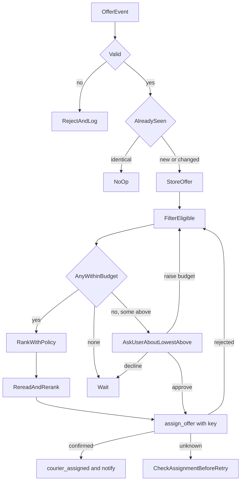

# Courier-offer handling and selection

**Status:** implemented  
**Date:** 2026-10-16

Starts when a booking is `booking_created` (awaiting offers). Receives courier offers from the logistics provider, keeps the eligible ones, selects the best offer within the user's budget, asks the user when nothing fits, and tells the user a courier is assigned only after the provider confirms the assignment.

## Locked decisions

- **Ranking is a replaceable `RankingPolicy`** with no weights; v1 ships `nearest-pickup-v1` (see "Ranking policy").
- **Ranking is a pure, deterministic function** of `(eligible offers, policy)`. The policy has an explicit `version`; the version and the full ordering are stored with each decision so a selection can be reproduced and audited. Final tie-break is fixed and documented (see open decision 5).
- **Budget is a hard filter, never a score.** An offer above the current approved budget is never selected without explicit user approval of that offer.
- **The provider is authoritative.** The AI says a courier is assigned only after the provider's assignment confirmation. A rejected assignment triggers re-evaluation of the remaining offers.
- **Per-booking budget.** Raising the budget changes this booking only; the session's collected `sender_max_budget` history is untouched and the change is recorded.
- Offers are stored on the session (SQLite document) so evaluation and recovery survive restarts.

## Algorithm

1. **Receive** an offer event (webhook or poll; delivery mechanism is an adapter concern).
2. **Validate**: booking reference matches this session's booking; `offer_id` present; price is a positive decimal in the booking's currency; status is a known value. Invalid events are rejected and logged, never stored as offers.
3. **Deduplicate** by `(booking_reference, offer_id)` and event id when the provider supplies one. A repeat of the same event is a no-op. A changed offer (same `offer_id`, different price/ETA/status) updates the stored offer and re-triggers evaluation; withdrawals and expiries arrive this way.
4. **Eligibility**: drop offers that are expired (`expires_at <= now`), withdrawn, or in any status other than the provider's "open" status.
5. **Evaluate** (re-run on every offer change, budget change, and approval, over all stored offers, not just the newest):
   - `within = eligible offers with price <= current budget`
   - if `within` is non-empty: rank with the policy, take the first, request assignment;
   - else if eligible offers exist: find the lowest-priced eligible offer above budget and ask the user whether to accept it (price, courier summary, by how much it exceeds budget); the user may approve that offer, raise the budget, or decline;
   - else: wait.
6. **Assignment**: send `assign_offer(booking_reference, offer_id, idempotency_key)`; one key per `(booking, offer)`. Concurrent-offer rule: before sending, re-read and re-rank the current eligible set; if a better offer has arrived since the decision was computed, use it.
   - confirmed -> store assignment, status `courier_assigned`, tell the user;
   - rejected / offer no longer available -> mark that offer unavailable and go back to step 5;
   - timeout / unknown -> look up the booking's assignment before retrying (same pattern as booking creation); never tell the user a courier is assigned without confirmation.
7. **User responses** while an above-budget offer is pending:
   - approve -> assign that specific offer (approval is recorded against the offer id and price; if the offer's price changes or it expires, approval is void);
   - raise budget to X -> update this booking's budget (validated positive, currency matches), re-evaluate all still-valid offers;
   - decline -> keep the request active; do nothing further. The provider's timeout and rebroadcast rules decide what happens next, and new or changed offers re-enter step 5.
8. **Notifications**: message the user only on meaningful changes: first time offers exist but none are within budget (approval question), courier assigned, assignment failed and no alternative, request expired/closed by provider. Not on every offer arrival, duplicate, or withdrawal of an offer that was never selected.



## State schema (proposed)

`BookingStatus` gains `offers_awaiting_approval`, `courier_assigned` (booking stays `booking_created` while waiting for offers). `Session.booking.offers` (`OfferState`, default null):

- `offers`: map `offer_id -> Offer`
  - `offer_id`, `courier_id`, `price`, `currency`, `status`, `expires_at`, `received_at`, `updated_at`
  - ranking inputs (only fields the agreed policy needs, e.g. `pickup_distance_km`, `eta_min`, `reliability`, `pickup_time`, `courier_likes`)
- `seen_event_ids`: bounded set for dedup
- `budget`: `{amount, currency, history: [{amount, at, reason}]}` (current approved limit for this booking)
- `pending_approval`: `{offer_id, price, requested_at}` or null
- `decision`: `{policy_version, ranked_offer_ids, chosen_offer_id, at}`
- `assignment`: `{offer_id, courier_id, status: requested|confirmed, idempotency_key, confirmed_at}` or null

## Failure handling

| Case | Behavior |
| --- | --- |
| Unknown booking reference / bad price / unknown status | Rejected, logged, no state change |
| Same event delivered twice | No-op; never a second assignment |
| Offer withdrawn or expired after being selected | Assignment not requested (or provider rejects); re-evaluate |
| Provider rejects the assignment | Offer marked unavailable; re-evaluate remaining |
| Assignment timeout, outcome unknown | Look up before retry; same key |
| Two offers arrive close together | Re-read and re-rank immediately before assigning |
| Budget raised to a value below some offers | Only offers within the new budget are selectable |
| User approves an above-budget offer whose price then changes | Approval void; ask again |
| Offer arrives after the booking closed/assigned | Stored for audit, ignored |

## Acceptance criteria -> where enforced

- No duplicate assignments: event dedup, per-offer assignment key, `courier_assigned` short-circuit.
- No above-budget selection without approval: budget is a filter before ranking; only the approval path can assign an over-budget offer, bound to offer id and price.
- Deterministic, testable ranking: pure function of offers + versioned policy, fixed tie-break, ordering stored.
- Expired/withdrawn cannot be selected: eligibility filter run at evaluation time and again immediately before assignment, with injected `now`.
- Provider authoritative: user told "assigned" only from a confirmed assignment response.
- Meaningful updates only: notification rules in step 8, tested.

## Ranking policy (decided)

Inputs from the product owner: the provider sends everything needed, including courier details; selection is simple: the offer must be within budget, then the courier who can pick up soonest (pickup time if the provider supplies it, otherwise distance to the pickup). Tolerance was left to design judgement. Applied here as fixed rules so results stay deterministic:

`nearest-pickup-v1` (no weights):

1. **Hard filter (before ranking):** eligible and `price <= current budget`.
2. **Metric:** if every within-budget candidate has `pickup_eta_min`, rank by it ascending. Otherwise rank by `pickup_distance_km` ascending, candidates without a distance last. (One metric per evaluation, so the order is total and units are never mixed.)
3. **Tolerance: none.** Values are compared exactly; any non-zero difference decides. A tolerance band would be an invented number; if wanted later it is a new policy version.
4. **Tie-break, in order:** lower price, earlier `received_at`, lower `offer_id`.
5. Courier likes, reliability and other courier details are **stored and shown, not scored**. The provider's courier details are passed through verbatim on the offer.

The decision (policy version, metric used, full order, chosen offer) is stored for audit.

## Assumptions to confirm (provider contract not yet defined)

- Event: `event_id?`, `booking_reference`, `offer_id`, `courier{courier_id, name?, phone?, details{}}`, `price`, `currency`, `status` (`open` | `withdrawn` | `expired`), `expires_at?`, `pickup_distance_km?`, `pickup_eta_min?`, `updated_at?` (older events for the same offer are ignored).
- `assign_offer(booking_reference, offer_id, idempotency_key)` confirms or raises "unavailable" (definite) / error-timeout (unknown); `find_assignment(booking_reference)` returns the assigned offer or none.
- Events arrive over `POST /v1/offers/events` (API-key authenticated, tenant-scoped) and user-facing updates are appended to the session as assistant messages, read by the SDK through `GET /v1/sessions/{id}`.
- **Selection is immediate:** the first evaluation that finds a within-budget offer assigns the best of the offers received *so far*. There is no hold window to wait for better offers. A hold window would be a product decision (it delays assignment).
- Above-budget approval covers only the offered courier and price; it does not raise the budget. Declining an offer suppresses re-asking about that same offer and price; the request stays open.
- Single-process locking per session only.

## Layout

```
app/offers/
  models.py    Offer, OfferState, Assignment, Decision (no collection imports; same constraint as other modules)
  provider.py  OfferProvider protocol: assign_offer, find_assignment; event types and errors
  ranking.py   RankingPolicy protocol and NearestPickupPolicy (nearest-pickup-v1), pure rank()
  fake.py      scriptable provider for tests
  prompts.py   user-facing wording
  engine.py    ingest(), evaluate(), on_user_message(), assignment with reconciliation
```

## Tests (planned)

Validation and dedup (duplicate, changed, withdrawn events); eligibility with expiry at evaluation and at assignment time; budget hard filter; ranking determinism with a test-only policy (same input, same order, tie-break); later-arriving better offer wins before assignment; provider rejection falls through to the next offer; assignment timeout reconciles; above-budget ask, approve, decline and raise-budget paths; approval voided by price change; notification only on meaningful changes; restart recovery via SQLite; no "assigned" message before provider confirmation.

## Follow-ups

- Real provider adapter and webhook/polling transport
- Cancellation, courier reassignment and delivery tracking after assignment
