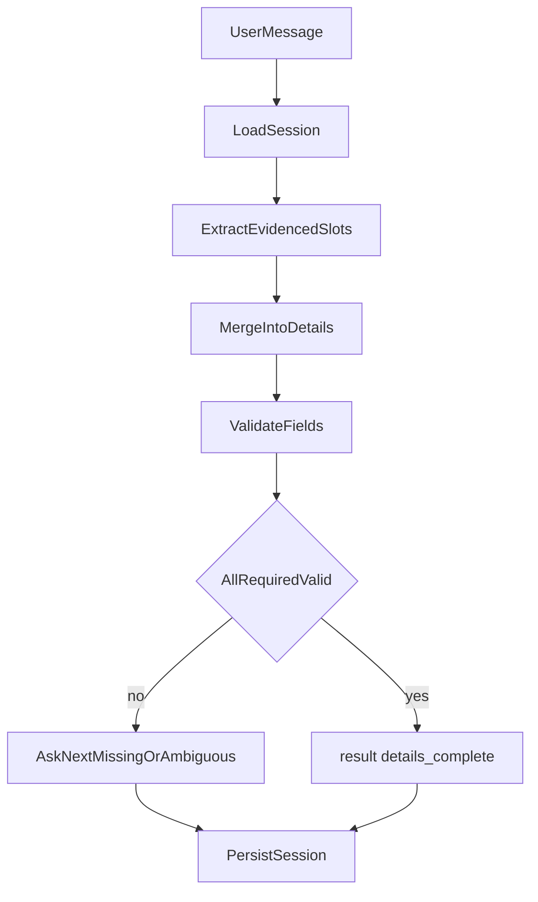

# Detail collection workflow

**Status:** implemented  
**Date:** 2026-10-16

Collect required delivery details from user messages, persist them on the session, and ask only for missing or unclear fields. Fare estimation, booking creation, and courier selection are out of scope until this module reports `details_complete`.

## Locked decisions

- The AI service **owns** conversation and collection state. The SDK sends `session_id` + the new user turn; the service loads saved state (algorithm step 2).
- Sender phone comes from the integrating provider on `POST /v1/sessions` (`sender_phone`). It is never requested from the user and is never inferred from chat.
- Extraction **must not invent** values. Unstated fields stay missing.
- Ask **one** clarifying question at a time, in field priority order. If the latest turn already supplies every remaining valid field, ask nothing.
- Sessions persist in SQLite so state survives process restarts.
- Extraction is a replaceable `Extractor`. v1 ships a deterministic rule-based extractor so tests and local runs do not need a model provider. An LLM extractor can drop in behind the same interface.

## Algorithm

1. SDK receives the user message.
2. SDK `POST /v1/sessions/{id}/messages` with the text (and channel). The service loads session state by id + tenant.
3. Extract evidenced delivery details from that turn (plus “this answers the last question” when the utterance has no other slots).
4. Merge extracted values into saved details. New values overwrite previous ones (corrections).
5. Validate every required field (format + address specificity).
6. If any field is missing, invalid, or ambiguous, ask only for the next such field.
7. Repeat on later turns until all required user fields are valid.
8. Set `booking.status` to `details_complete` and return a structured `result` so fare estimation can start.



## State schema

`Session.booking` is the collection document.

### Fields (priority order)

| Field | Source | Required of user |
| --- | --- | --- |
| `pickup_address` | chat | yes |
| `destination_address` | chat | yes |
| `package_description` | chat | yes |
| `recipient_name` | chat | yes |
| `recipient_phone` | chat | yes |
| `sender_max_budget` | chat | yes |
| `sender_phone` | provider on session create | no |

Each collected field:

- `value`: string or null
- `status`: `missing` | `valid` | `ambiguous` | `invalid`
- `issue`: human-readable reason when not valid

Budget also stores parsed `amount` (decimal string) and `currency` (ISO-like code when present).

`booking.status`: `collecting` | `details_complete` (later: `ready_for_quote`, …).

`booking.missing_fields` / `booking.ambiguous_fields`: ordered slot names.

`booking.next_actions`: one action, either `ask_user` + `field` + `prompt`, or `none` when complete.

`booking.result` when complete:

```json
{
  "type": "details_complete",
  "pickup_address": "...",
  "destination_address": "...",
  "package_description": "...",
  "recipient_name": "...",
  "recipient_phone": "...",
  "sender_max_budget": { "amount": "8000", "currency": "NGN" },
  "sender_phone": "+2348030000000"
}
```

## Validation rules

- **pickup_address / destination_address:** Must include a street-level cue (house/street number **or** a street/road/avenue/close/drive/way/boulevard keyword) **and** a locality cue (comma-separated area/city, or a second comma part). Too short (< 8 characters), single-token, or vague landmarks (`mall`, `airport`, `downtown`, `home`, `my house`, `there`) are `ambiguous`, not filled as valid. The engine does not geocode in v1.
- **package_description:** Trimmed length ≥ 3. Not a phone number or a pure address copy.
- **recipient_name:** At least two letters; not only digits.
- **recipient_phone:** At least 8 digits after stripping separators; optional leading `+`. Letters → `invalid`.
- **sender_max_budget:** Parsed amount > 0. Optional currency symbol/code. Amount ≤ 0 → `invalid`.
- **sender_phone:** Same phone rules; supplied by provider; missing on create → `422`.

The engine never copies a missing field from another field or from training-set defaults.

## Prompts

- **Greeting** (session create): invite the user to provide pickup, destination, package, recipient name/phone, and max budget. Do not ask for the sender’s phone.
- **Follow-up:** only the next missing/ambiguous/invalid field (see `app/collection/prompts.py`).
- **Complete:** confirm that details are complete and fare estimation can proceed. No extra questions.

## Edge cases

| Case | Behavior |
| --- | --- |
| One message with all valid slots | `details_complete`; no follow-up question |
| Progressive turns | Merge; ask only what remains |
| Correction (“pickup is actually …”) | Overwrite that slot; re-validate |
| Vague address (“the mall”) | `ambiguous`; ask for a fuller address |
| User phone in chat | May fill **recipient** phone if labeled/contextual; never `sender_phone` |
| Complete then a bad correction | Status returns to `collecting`; `result` cleared |
| Duplicate `client_message_id` | Same assistant reply; no second merge |
| Unknown / other-tenant session | `404` |
| Session not `active` | `409` |

## Tests

- Extractor: labeled blob, from/to sentence, last-question fallback, ignore sender phone.
- Validator: valid vs vague addresses, phones, budget.
- Engine: complete in one turn; progressive fill; correction; ambiguity; no invention.
- Store: SQLite reload after a new store instance (restart).
- API: create requires `sender_phone`; message flow updates `booking`.

## Follow-ups

- LLM extractor behind `Extractor`
- Address geocoding / place autocomplete
- Fare estimation taking `details_complete`
